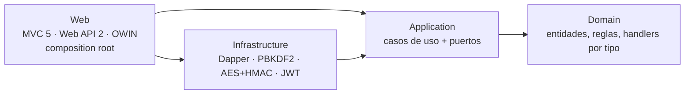
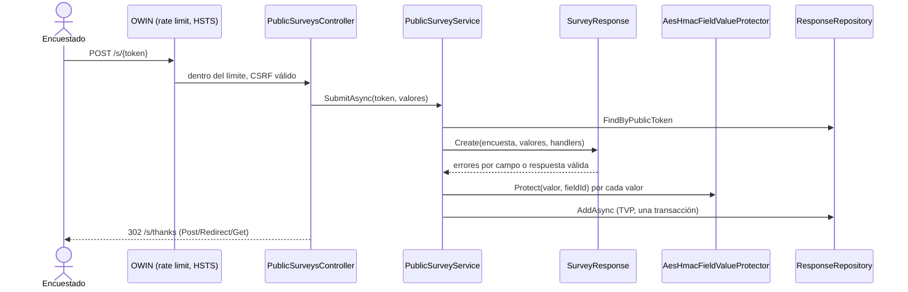

# Arquitectura

## Capas

| Proyecto | Responsabilidad | Depende de |
|---|---|---|
| Domain | Encuesta válida, reglas de edición con respuestas, validación y normalización por tipo | Nada |
| Application | Casos de uso (login, CRUD, llenado, resultados), verificación de dueño, auditoría y cifrado mediante interfaces | Domain |
| Infrastructure | Implementa los puertos: repositorios Dapper, hash, cifrado, JWT, bitácora | Application |
| Web | Controladores, vistas, API, filtros y middleware. Único lugar donde se conectan interfaces e implementaciones (Autofac) | Todos |

Cuatro proyectos es el mínimo para que el compilador haga cumplir la regla de dependencia. Application se prueba con
dobles en memoria, y cambiar Dapper o PBKDF2 solo afecta a Infrastructure.

## Flujo: envío de una respuesta pública

## Patrones

| Patrón | Dónde | Motivo |
|---|---|---|
| Strategy + registro | `IFieldValueHandler`, `FieldValueHandlerRegistry` | Validación por tipo sin `switch` repetidos; falla al arrancar si un tipo no tiene handler |
| Result/Error | `Domain/Common` | Las fallas esperadas son valores, no excepciones |
| Agregado | `Survey` + `SurveyField`, `SurveyResponse` + `Answer` | Invariantes en un solo lugar; se guarda completo |
| Repository / Ports & Adapters | `Application/Abstractions` | Application declara qué necesita; Infrastructure decide cómo |
| CQRS ligero | `SurveySummary`, `EncryptedResultsPage` | Lecturas con proyecciones e índices cubrientes |
| Post/Redirect/Get | Formularios | F5 no reenvía datos |
| Filtros globales | `FilterConfig` | `[Authorize]`, anti-CSRF y HTTPS por defecto; las excepciones son explícitas |

## Decisiones

| Decisión | Alternativa descartada | Motivo |
|---|---|---|
| Vistas Razor | SPA separado | MVC ya es *full stack*; un SPA sumaría CORS, otro despliegue y tokens en el navegador |
| Dapper + SQL explícito | Entity Framework 6 | TVPs, `ROWVERSION`, índices filtrados y paginación de un viaje, visibles y justificables |
| Scripts SQL versionados | Migraciones | Esquema revisable línea por línea |
| Tabla `Users` propia | ASP.NET Identity 2 | Identity usa PBKDF2-SHA1 con 1000 iteraciones y agrega 5 tablas |
| Cookie (web) + JWT (API) | Solo JWT | Un JWT en `localStorage` queda expuesto a XSS |
| Sin Session State | Session en proceso | Sin estado en el servidor; TempData va en cookie cifrada |
| PBKDF2 con CNG (`BCryptDeriveKeyPBKDF2`) | `Rfc2898DeriveBytes` | La versión gestionada de .NET Framework es ~10× más lenta; el hash es idéntico |
| Campos identificados por `name` en la API | Exponer el id interno del campo | La API nunca expone ids internos; el nombre ya es único por encuesta |
| Rate limit propio en OWIN | Paquete de terceros | No hay paquete mantenido para OWIN 4; en la nube se delegaría al WAF |
| Capas internas SDK-style `net48` | `.csproj` clásicos | `PackageReference` y `dotnet build`; el proyecto web sigue clásico por las herramientas de MVC 5 |
| Swashbuckle.Core + swagger-ui 5 local | UI embebida de Swashbuckle | La UI embebida es swagger-ui 2.x, con XSS conocidos; la 5.x local cumple la CSP |

## Convenciones

- Un tipo por archivo, con el mismo nombre (`Result<T>` en `ResultOfT.cs`).
- El namespace refleja la carpeta, salvo `App_Start`, que usa el namespace raíz como la plantilla de Microsoft.
- Comentarios XML solo en la API (alimentan Swagger); en el resto, comentarios únicamente donde la razón técnica no
  es evidente.
- Pruebas: `Método_Escenario_ResultadoEsperado`, Arrange/Act/Assert y una clase por componente.
