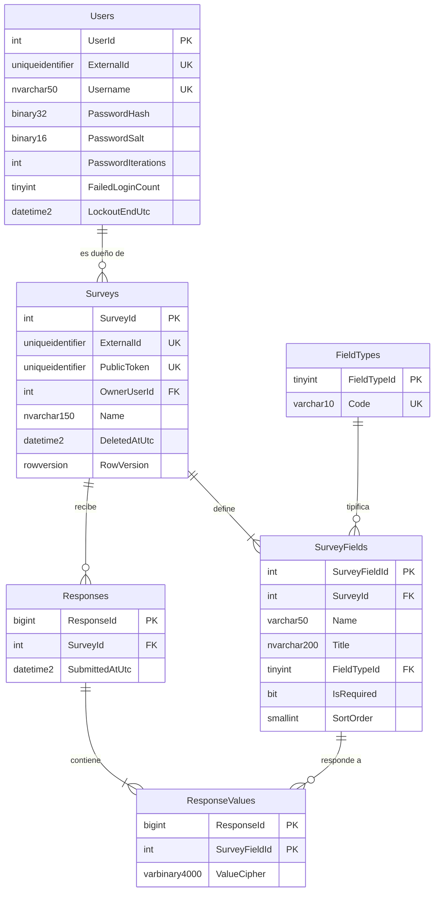

# Base de datos

SQL Server 2016 o superior (LocalDB en desarrollo). Scripts en `database/`, en orden:

| Script | Contenido |
|---|---|
| `00_create_database.sql` | BD con *collation* `Latin1_General_100_CI_AS_SC` y `READ_COMMITTED_SNAPSHOT` |
| `01_schema.sql` | Tablas, restricciones, índices y tipos tabla (TVP) |
| `02_seed.sql` | Usuarios demo (hash precalculado) y una encuesta de ejemplo |
| `03_least_privilege_login.sql` | Producción: rol con permisos mínimos |

## Modelo

## Normalización (3FN)

- **1FN:** los campos y los valores son filas (`SurveyFields`, `ResponseValues`), no listas ni JSON.
- **2FN:** en `ResponseValues` el único atributo no clave (`ValueCipher`) depende de la PK completa; la fecha de
  envío vive en `Responses`.
- **3FN:** sin dependencias transitivas; el nombre del tipo está en el catálogo `FieldTypes`.

Se eligió **fila por valor** porque los campos se definen en tiempo de ejecución. Una tabla por encuesta exigiría
DDL dinámico, y una columna JSON rompería 1FN e impediría FK por campo. Como el valor va cifrado, la columna es
binaria de todas formas; el tipo se garantiza en la aplicación antes de cifrar.

## Tipos de datos

| Columna | Tipo | Motivo |
|---|---|---|
| `PasswordHash` / `PasswordSalt` | `BINARY(32)` / `BINARY(16)` | Longitud fija de PBKDF2-SHA256 y de la sal |
| `PasswordIterations` | `INT` + `CHECK >= 100000` | Costo por usuario: permite subirlo y re-hashear al iniciar sesión |
| `FieldTypeId` | `TINYINT` | Catálogo pequeño, 1 byte por fila |
| `SurveyFields.Name` | `VARCHAR(50)` + `CHECK` | Identificador técnico ASCII; la regla también vive en la BD |
| Títulos y descripciones | `NVARCHAR` | Texto visible con acentos y emojis |
| Fechas | `DATETIME2(0)` en UTC | 6 bytes, precisión de segundos; se convierte a hora local solo al mostrar |
| `RowVersion` | `ROWVERSION` | Concurrencia optimista sin bloqueos |
| `ValueCipher` | `VARBINARY(4000)` | Cabe en la fila (sin páginas LOB); `CHECK >= 66` bytes, el mínimo de un cifrado válido |
| `ResponseId` | `BIGINT` | Tabla de mayor crecimiento |

## Identificadores

| Identificador | Tipo | Uso |
|---|---|---|
| PK (`UserId`, `SurveyId`, `SurveyFieldId`, `ResponseId`) | `INT`/`BIGINT IDENTITY` | Solo dentro de la BD: clustered compacto y creciente, *joins* y FK baratos |
| `Surveys.ExternalId` | UUID v4 | URLs privadas; evita enumeración (IDOR) |
| `Surveys.PublicToken` | UUID v4 | Link público; separado de `ExternalId` para poder rotarlo |
| `Users.ExternalId` | UUID v4 | Claim `sub` del JWT |

Se usa v4 porque v1/v6/v7 exponen la marca de tiempo y v3/v5 son deterministas. Los UUID se generan con un CSPRNG en
la aplicación. No son PK porque un UUID aleatorio fragmenta el índice clustered y ocupa 16 bytes en cada FK.

## Índices

| Índice | Atiende |
|---|---|
| `IX_Surveys_Owner_Active` (filtrado `DeletedAtUtc IS NULL`, cubriente) | Listado "Mis encuestas" |
| `UQ_SurveyFields_Survey_Name` | Unicidad del nombre y campos de una encuesta |
| `IX_Responses_Survey (SurveyId, ResponseId DESC)` | Paginación de resultados sin `SORT` |
| PK `ResponseValues (ResponseId, SurveyFieldId)` | Valores de la página por *seek* |
| `IX_ResponseValues_SurveyField` | Índice de la FK |

## Integridad y escrituras

- FK en todas las relaciones; `ON DELETE CASCADE` solo en `ResponseValues → Responses`.
- *Soft delete* de encuestas: conserva los resultados y desactiva el link.
- Con respuestas no se puede cambiar el tipo ni borrar campos. Lo valida el dominio y otra vez el `UPDATE`, con
  `UPDLOCK, HOLDLOCK` dentro de la transacción.
- Cada escritura es un solo lote con TVP, `SET XACT_ABORT ON` y transacción explícita.
- Concurrencia optimista con `WHERE RowVersion = @RowVersion`.
- Todo el SQL está parametrizado.

## Lectura de datos cifrados

1. `OFFSET/FETCH` sobre `IX_Responses_Survey`: solo se leen y descifran las filas de la página.
2. Un viaje con tres *result sets* (total, cabeceras, valores) sobre una variable de tabla: sin N+1.
3. Claves derivadas una vez (singleton) y pivote con diccionarios en O(R + V).
